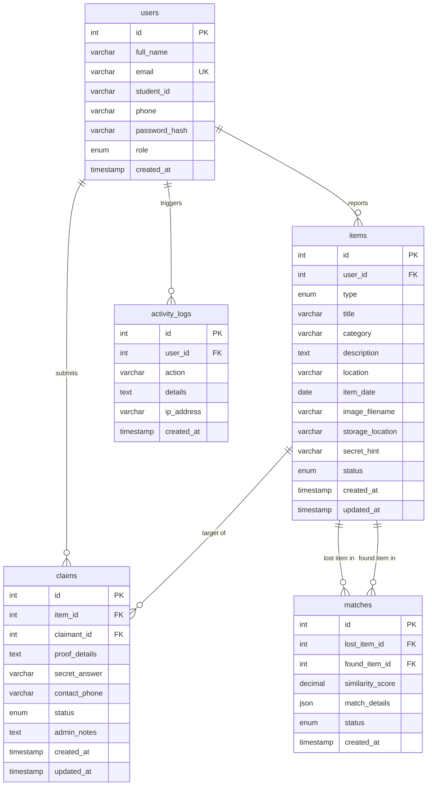

# CampusFind — Database Design & Schema Specification

> **Project:** Smart Lost & Found System (CampusFind)  
> **Course:** Bachelor of Technology (BTech) in Computer Science & Engineering (CSE)  
> **Author:** Two-Person BTech CSE Capstone Project Team  
> **Target RDBMS:** MySQL 8.0+ / MariaDB 10.4+ (InnoDB Engine) with Automatic SQLite 3 Fallback  

---

## 1. Entity-Relationship (ER) Overview

CampusFind utilizes an ACID-compliant relational schema consisting of five interconnected entities. All relationships enforce referential integrity using explicit foreign key constraints with appropriate cascade/nullify actions:



---

## 2. Table Specifications

### 2.1 Table: `users`
Maintains user profiles across student, faculty/staff, and administrator roles.

| Column | Data Type | Nullable | Constraints & Default | Description |
| :--- | :--- | :---: | :--- | :--- |
| `id` | `INT` | No | `AUTO_INCREMENT PRIMARY KEY` | Unique surrogate identifier |
| `full_name` | `VARCHAR(120)` | No | None | User's full display name |
| `email` | `VARCHAR(150)` | No | `UNIQUE` | Normalized campus email address |
| `student_id`| `VARCHAR(50)` | Yes | `DEFAULT NULL` | University registration / Roll number |
| `phone` | `VARCHAR(30)` | Yes | `DEFAULT NULL` | Contact telephone number |
| `password_hash` | `VARCHAR(255)` | No | None | Salted Scrypt/PBKDF2 password hash |
| `role` | `ENUM('student', 'staff', 'admin')` | No | `DEFAULT 'student'` | Access role for authorization gating |
| `created_at` | `TIMESTAMP` | No | `DEFAULT CURRENT_TIMESTAMP` | Account creation timestamp |

- **Indexes:**
  - `idx_user_email` (`email`): Accelerates credential lookups during login.
  - `idx_user_role` (`role`): Optimizes administrative queries and user filtering.

---

### 2.2 Table: `items`
Maintains unified lost and found report records.

| Column | Data Type | Nullable | Constraints & Default | Description |
| :--- | :--- | :---: | :--- | :--- |
| `id` | `INT` | No | `AUTO_INCREMENT PRIMARY KEY` | Unique report identifier |
| `user_id` | `INT` | No | `FOREIGN KEY REFERENCES users(id) ON DELETE CASCADE` | Reporter user ID |
| `type` | `ENUM('lost', 'found')` | No | None | Item classification type |
| `title` | `VARCHAR(180)` | No | None | Brief descriptive title |
| `category` | `VARCHAR(60)` | No | None | Normalized item classification category |
| `description` | `TEXT` | No | None | Comprehensive item description & marks |
| `location` | `VARCHAR(150)` | No | None | Campus zone where lost or discovered |
| `item_date` | `DATE` | No | None | Date of occurrence |
| `image_filename` | `VARCHAR(255)` | Yes | `DEFAULT NULL` | Sanitized filename of uploaded image |
| `storage_location`| `VARCHAR(150)` | Yes | `DEFAULT NULL` | Physical custody desk (Found items only) |
| `secret_hint` | `VARCHAR(255)` | Yes | `DEFAULT NULL` | Challenge hint question (Lost items only) |
| `status` | `ENUM('open', 'claimed', 'returned', 'resolved', 'closed')` | No | `DEFAULT 'open'` | Lifecycle workflow state |
| `created_at` | `TIMESTAMP` | No | `DEFAULT CURRENT_TIMESTAMP` | Submission timestamp |
| `updated_at` | `TIMESTAMP` | No | `DEFAULT CURRENT_TIMESTAMP ON UPDATE CURRENT_TIMESTAMP` | Last status modification timestamp |

- **Indexes:**
  - `idx_items_type` (`type`): Partitions searches between lost and found items.
  - `idx_items_category` (`category`): Accelerates category browse filters.
  - `idx_items_status` (`status`): Filters open vs. resolved repository records.
  - `idx_items_date` (`item_date`): Supports chronological ordering and sorting.
  - `idx_items_location` (`location`): Optimizes campus zone filtering.

---

### 2.3 Table: `claims`
Stores ownership claims filed by students against found items.

| Column | Data Type | Nullable | Constraints & Default | Description |
| :--- | :--- | :---: | :--- | :--- |
| `id` | `INT` | No | `AUTO_INCREMENT PRIMARY KEY` | Unique claim identifier |
| `item_id` | `INT` | No | `FOREIGN KEY REFERENCES items(id) ON DELETE CASCADE` | Found item being claimed |
| `claimant_id` | `INT` | No | `FOREIGN KEY REFERENCES users(id) ON DELETE CASCADE` | Claimant user ID |
| `proof_details` | `TEXT` | No | None | Distinctive marks, receipts, serial numbers |
| `secret_answer` | `VARCHAR(255)` | Yes | `DEFAULT NULL` | Claimant's answer to item's secret hint |
| `contact_phone` | `VARCHAR(30)` | No | None | Claimant's phone for admin contact |
| `status` | `ENUM('pending', 'approved', 'rejected')` | No | `DEFAULT 'pending'` | Administrative review state |
| `admin_notes` | `TEXT` | Yes | `DEFAULT NULL` | Administrator review justification remarks |
| `created_at` | `TIMESTAMP` | No | `DEFAULT CURRENT_TIMESTAMP` | Claim filing timestamp |
| `updated_at` | `TIMESTAMP` | No | `DEFAULT CURRENT_TIMESTAMP ON UPDATE CURRENT_TIMESTAMP` | Review decision timestamp |

- **Indexes:**
  - `idx_claims_status` (`status`): Quick lookup for pending review queue.
  - `idx_claims_item` (`item_id`): Links claims to target found item.
  - `idx_claims_claimant` (`claimant_id`): Displays user's submitted claims on dashboard.

---

### 2.4 Table: `matches`
Persists computed similarity pairings between lost and found items.

| Column | Data Type | Nullable | Constraints & Default | Description |
| :--- | :--- | :---: | :--- | :--- |
| `id` | `INT` | No | `AUTO_INCREMENT PRIMARY KEY` | Match record identifier |
| `lost_item_id` | `INT` | No | `FOREIGN KEY REFERENCES items(id) ON DELETE CASCADE` | Associated lost report |
| `found_item_id`| `INT` | No | `FOREIGN KEY REFERENCES items(id) ON DELETE CASCADE` | Associated found report |
| `similarity_score` | `DECIMAL(5, 2)` | No | None | Composite score ($0.00$ to $100.00$) |
| `match_details` | `JSON` | Yes | `DEFAULT NULL` | Detailed factor-by-factor score breakdown |
| `status` | `ENUM('potential', 'verified', 'dismissed')` | No | `DEFAULT 'potential'` | Verification status |
| `created_at` | `TIMESTAMP` | No | `DEFAULT CURRENT_TIMESTAMP` | Match computation timestamp |

- **Indexes:**
  - `idx_matches_score` (`similarity_score`): Filters top-ranking candidate pairs.
  - `idx_matches_pair` (`lost_item_id`, `found_item_id`): Composite index preventing redundant scans.

---

### 2.5 Table: `activity_logs`
Provides an immutable audit trail of administrative moderation actions and key user events.

| Column | Data Type | Nullable | Constraints & Default | Description |
| :--- | :--- | :---: | :--- | :--- |
| `id` | `INT` | No | `AUTO_INCREMENT PRIMARY KEY` | Log entry identifier |
| `user_id` | `INT` | Yes | `FOREIGN KEY REFERENCES users(id) ON DELETE SET NULL` | Performing user ID |
| `action` | `VARCHAR(80)` | No | None | Action identifier (e.g. `CLAIM_APPROVE`) |
| `details` | `TEXT` | Yes | `DEFAULT NULL` | Human-readable action description |
| `ip_address` | `VARCHAR(45)` | Yes | `DEFAULT NULL` | Client IP address |
| `created_at` | `TIMESTAMP` | No | `DEFAULT CURRENT_TIMESTAMP` | Action timestamp |

- **Indexes:**
  - `idx_logs_action` (`action`): Enables action-specific log filtering.
  - `idx_logs_created_at` (`created_at`): Enables chronological log pagination.

---

## 3. Database Indexing Analysis: B+ Tree vs. In-Memory BST

### 3.1 On-Disk MySQL B+ Tree Indexes
In MySQL InnoDB, table records are physically organized as clustered B+ Trees keyed on primary keys (`id`):
- **High Fan-Out ($M \ge 100$):** Each 16 KB page stores hundreds of index keys, limiting tree depth to $3 - 4$ levels even for millions of records.
- **Disk I/O Minimization:** Locating any record requires at most 3 to 4 block reads from secondary storage.
- **Linked Leaf Nodes:** Leaf nodes form a doubly linked list, enabling rapid range scans for date filters (`WHERE item_date BETWEEN ? AND ?`).

### 3.2 In-Memory Python Binary Search Tree
While InnoDB's B+ Tree indexes manage secondary storage persistence, our in-memory **Binary Search Tree (BST)** operates directly in RAM:
- **Nanosecond Pointer Dereferencing:** Lookups follow memory addresses directly without buffer pool lookups, disk latency, or SQL parser overhead.
- **Natural $O(n)$ In-Order Traversal:** Delivers items sorted in ascending order without running an external $O(n \log n)$ sorting algorithm.
- **Pedagogical Visualization:** Serves an academic purpose by translating in-memory tree nodes and branch traversals into interactive SVG graphics.

---

## 4. Dual-Engine Architecture & SQL Translation

[`app/db.py`](file:///c:/Users/6tan5/OneDrive/Desktop/smart%20lost%20&%20found%20system/app/db.py) abstracts database operations so the application runs identically on MySQL and SQLite:

1. **Parameter Placeholder Normalization:**
   ```python
   # Application code writes standard %s placeholders:
   query_db("SELECT * FROM items WHERE category = %s AND status = %s", (cat, status))

   # In SQLite mode, the adapter automatically translates %s -> ?:
   if self.db_type == 'sqlite':
       query = query.replace('%s', '?')
   ```
2. **Boolean / Enum Handling:**
   - MySQL evaluates `ENUM('lost', 'found')` and `ENUM('open', 'claimed', 'returned', 'resolved')`.
   - SQLite evaluates these columns as `TEXT` with `CHECK` constraints, maintaining schema integrity.
3. **Date Function Compatibility:**
   - Standard ANSI SQL queries are used across both backends, avoiding engine-specific non-standard syntax.
4. **Foreign Key Enforcement:**
   - In SQLite mode, the adapter executes `PRAGMA foreign_keys = ON;` upon establishing each connection to ensure cascade deletions (`ON DELETE CASCADE`) are strictly honored.
